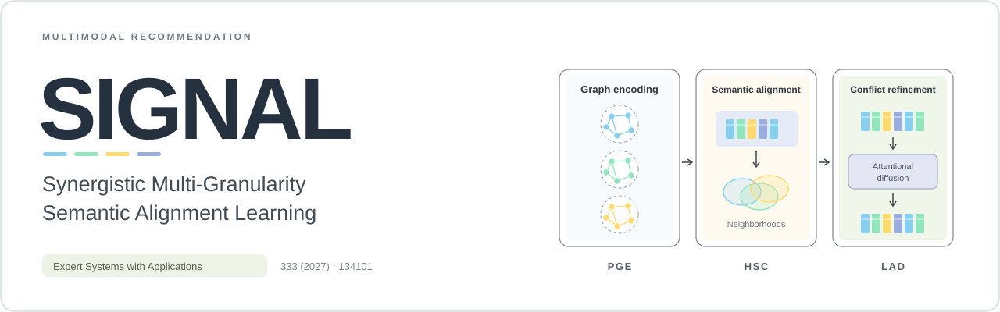
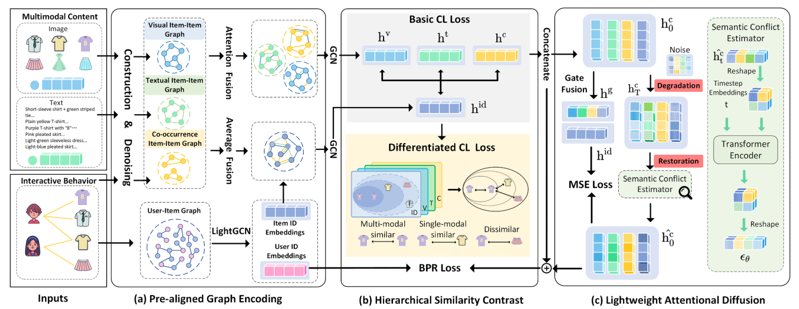
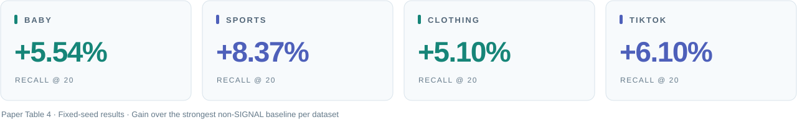

<div align="center">



### Synergistic Multi-Granularity Semantic Alignment Learning<br>for Multimodal Recommendation

<sub>Expert Systems with Applications · Volume 333 · 2027 · Article 134101</sub>

Meizi Li<sup>†</sup>, Hang Gao<sup>†</sup>, Bo Zhang, Yang Yu, Guojian Zou<sup>*</sup>, Ling Ding<sup>*</sup>

<sup>†</sup> Equal contribution &nbsp; <sup>*</sup> Corresponding authors

[](https://doi.org/10.1016/j.eswa.2026.134101)
[](https://github.com/enoche/MMRec)
[](LICENSE)

**[Read the paper](https://doi.org/10.1016/j.eswa.2026.134101)** &nbsp; / &nbsp; **[PDF](docs/paper/SIGNAL.pdf)** &nbsp; / &nbsp; **[Explore the code](src/models/signal.py)** &nbsp; / &nbsp; **[中文](README.zh-CN.md)**

</div>

---

<p align="center">
  <a href="#overview">Overview</a> &nbsp; · &nbsp; <a href="#framework">Framework</a> &nbsp; · &nbsp; <a href="#results">Results</a> &nbsp; · &nbsp; <a href="#getting-started">Getting started</a> &nbsp; · &nbsp; <a href="#citation">Citation</a>
</p>

## Overview

This repository hosts the implementation of **SIGNAL**, built on the [MMRec](https://github.com/enoche/MMRec) framework. SIGNAL combines graph encoding, contrastive alignment, and lightweight attentional diffusion to learn multimodal semantics at both holistic and partial granularities.

Existing encoding–alignment pipelines can disrupt semantic neighborhoods and leave fine-grained cross-modal conflicts unresolved. SIGNAL connects these stages: graph encoding prepares aligned representations, contrastive learning preserves their neighborhood structure, and diffusion refines remaining semantic conflicts.

## Framework

<p align="center">
  
</p>

*Figure 2 from the paper. PGE and HSC cooperate on holistic semantic alignment; LAD refines partial semantic conflicts.*

<table>
<tr>
<td width="33%" valign="top">
<sub><b>01 / ENCODE</b></sub>
<h3>PGE</h3>
<b>Pre-aligned Graph Encoding</b>
<p>Inter-graph attention fuses modality-specific structures, establishing preliminary alignment during encoding.</p>
</td>
<td width="33%" valign="top">
<sub><b>02 / ALIGN</b></sub>
<h3>HSC</h3>
<b>Hierarchical Similarity Contrast</b>
<p>Basic and differentiated contrast align representations while preserving graph-encoded semantic neighborhoods.</p>
</td>
<td width="33%" valign="top">
<sub><b>03 / REFINE</b></sub>
<h3>LAD</h3>
<b>Lightweight Attentional Diffusion</b>
<p>Reliability-aware guidance refines cross-modal conflicts with a small number of restoration steps.</p>
</td>
</tr>
</table>

The co-occurrence graph is a behavior-aware view built from **training interactions only**. It complements the visual and textual item graphs.

## Results



The following values are from **Table 4** of the paper, using its fixed-seed comparison protocol. R@K denotes Recall@K; N@K denotes NDCG@K. The final column compares R@20 with the strongest non-SIGNAL baseline for each dataset.

| Dataset | R@10 | R@20 | N@10 | N@20 | R@20 improvement |
| :--- | ---: | ---: | ---: | ---: | ---: |
| Baby | 0.0679 | **0.1047** | 0.0368 | **0.0463** | +5.54% |
| Sports | 0.0783 | **0.1180** | 0.0424 | **0.0526** | +8.37% |
| Clothing | 0.0674 | **0.0989** | 0.0367 | **0.0446** | +5.10% |
| TikTok | 0.0772 | **0.1165** | 0.0408 | **0.0506** | +6.10% |

The paper also reports four-seed stability results in Table 5, module ablations, synergy analysis, and robustness under sparse interactions and noisy features. Refer to the [paper](docs/paper/SIGNAL.pdf) for the full comparisons and experimental conditions.

## Getting started

### 1. Get the repository

```bash
git clone https://github.com/Sail-high/SIGNAL.git
cd SIGNAL
```

### 2. Prepare an environment

```bash
conda env create -f environment.yml
conda activate signal
```

The environment preserves the inherited PyTorch 1.11 dependency baseline and uses Python 3.9. The current model uses CUDA-specific operations; the paper reports experiments on an NVIDIA RTX A40 with 48 GB memory. See [environment and implementation notes](docs/REPRODUCIBILITY.md#environment).

### 3. Prepare data and experiment settings

See [data preparation](data/README.md) for the required interaction files, feature arrays, and co-occurrence graph.

The training entry point accepts the model and dataset names:

```bash
cd src
python main.py --model SIGNAL --dataset baby
```

Run from `src/`: the inherited loader resolves `configs/` and `../data/` relative to the working directory. See the [experiment settings](docs/REPRODUCIBILITY.md) for the paper’s hyperparameters and configuration conventions.

## Repository structure

**[Model](src/models/signal.py)** · **[Training](src/main.py)** · **[Data](data/README.md)** · **[Experiment settings](docs/REPRODUCIBILITY.md)**

<details>
<summary>View the complete repository layout</summary>

```text
SIGNAL/
├── README.md                   # Project overview
├── README.zh-CN.md              # Chinese overview
├── CITATION.cff                 # Machine-readable paper citation
├── environment.yml             # Environment setup
├── requirements.txt            # Python dependencies
├── src/
│   ├── main.py                 # Training entry point
│   ├── models/signal.py        # SIGNAL and LAD implementation
│   ├── configs/                # Inherited dataset / baseline settings
│   ├── common/                 # MMRec trainer and shared modules
│   └── utils/                  # Loading, evaluation, and configuration
├── data/README.md              # Dataset preparation
├── preprocessing/              # Inherited MMRec preprocessing tools
├── evaluation/                 # Inherited evaluation documentation
└── docs/
    ├── assets/                 # Project graphics and paper figure
    ├── paper/SIGNAL.pdf        # Paper
    ├── REPRODUCIBILITY.md      # Paper settings and configuration
    └── upstream/              # Original MMRec documentation and assets
```

</details>

The other models in `src/models/` are inherited MMRec baselines. Their presence does not imply that every baseline evaluated in the SIGNAL paper is included here.

## Citation

If SIGNAL is useful for your research, please cite:

```bibtex
@article{li2027signal,
  title   = {{SIGNAL}: Synergistic multi-granularity semantic alignment learning for multimodal recommendation},
  author  = {Li, Meizi and Gao, Hang and Zhang, Bo and Yu, Yang and Zou, Guojian and Ding, Ling},
  journal = {Expert Systems with Applications},
  volume  = {333},
  pages   = {134101},
  year    = {2027},
  doi     = {10.1016/j.eswa.2026.134101}
}
```

The bibliographic year is **2027**, as printed in the journal volume; the article was available online on **19 August 2026**.

## Acknowledgements and license

SIGNAL is developed on top of [MMRec](https://github.com/enoche/MMRec). We thank its authors and contributors for the training, data-loading, evaluation, and baseline implementations. The original MMRec documentation is preserved in [docs/upstream/MMRec-README.md](docs/upstream/MMRec-README.md); framework attribution and its citation are in [ACKNOWLEDGEMENTS.md](ACKNOWLEDGEMENTS.md).

The inherited [GNU GPL v3 license](LICENSE) and source attribution are retained. The article and its figures retain their respective publication notices.

## Contact

For questions about SIGNAL, please contact **Hang Gao (高航)** at [1000566340@smail.shnu.edu.cn](mailto:1000566340@smail.shnu.edu.cn), or open a [GitHub issue](https://github.com/Sail-high/SIGNAL/issues).
